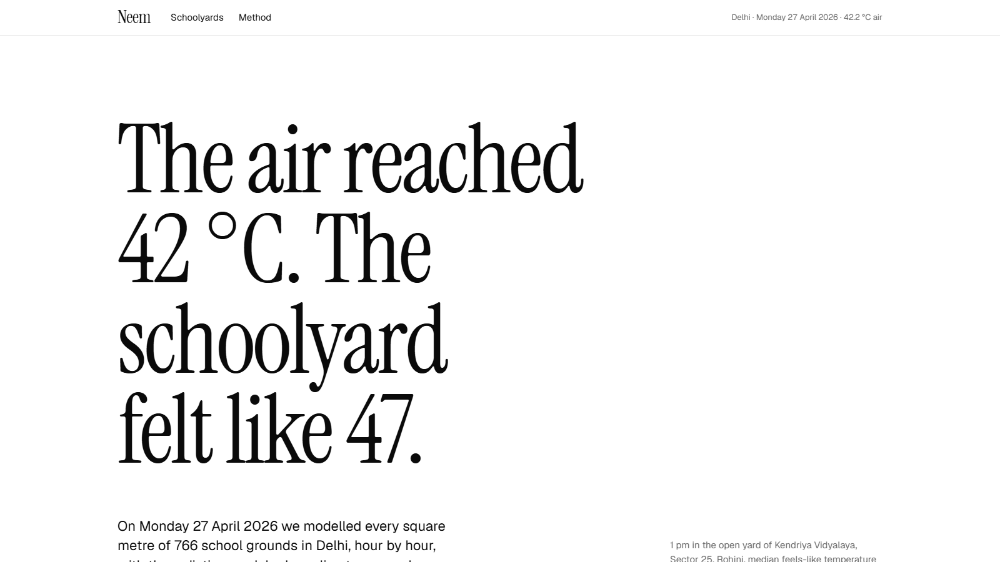
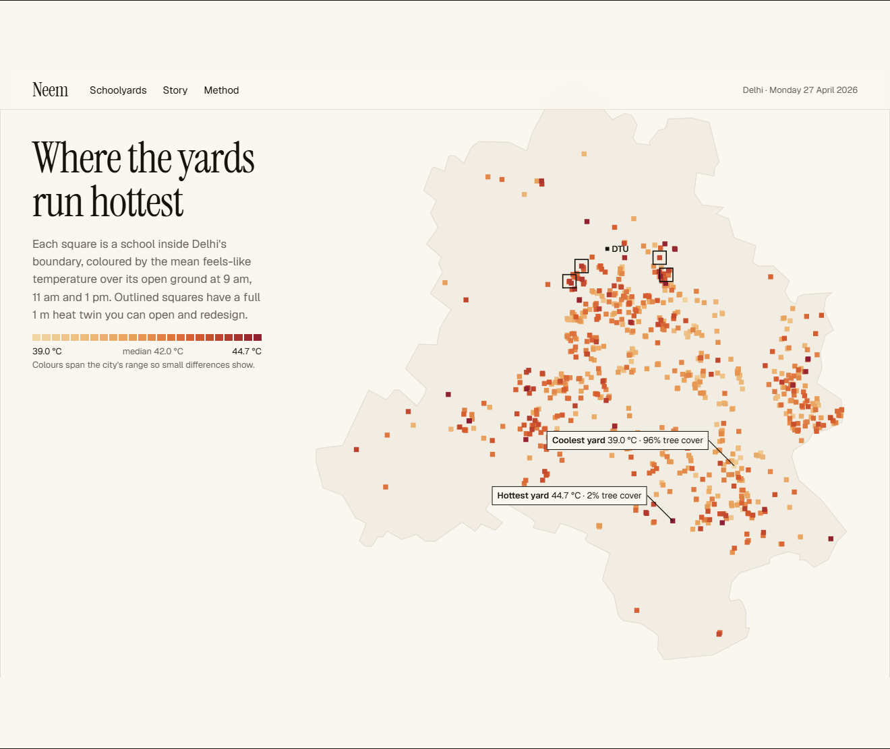
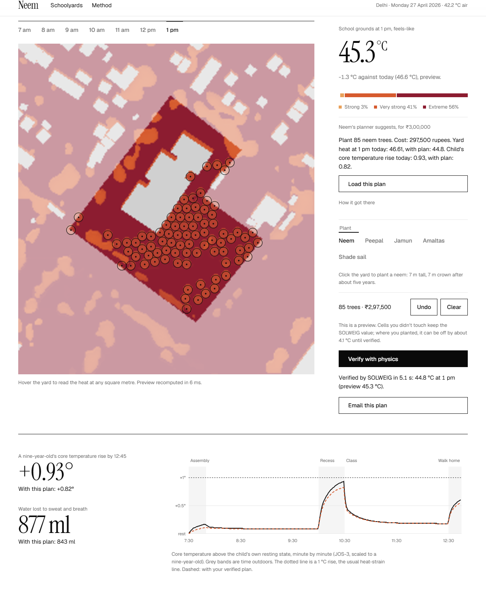
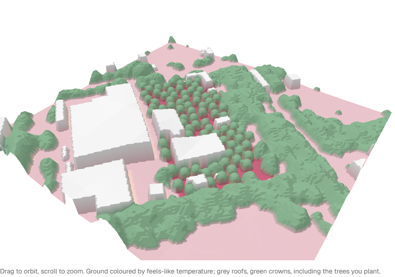

# Neem

**The air reached 42 °C. The schoolyard felt like 47.**

Neem works out how hot every square metre of a Delhi schoolyard feels to a child on a heatwave day. Then it shows what a few lakh rupees of neem trees would change, before anyone picks up a spade.

Live: **[neem-lemon.vercel.app](https://neem-lemon.vercel.app)** · the story behind it: **[/story](https://neem-lemon.vercel.app/story)**



## What it found

On Monday 27 April 2026, Delhi's hottest school day before the summer break, we modelled the open ground of **766 schools**.



- **Tree canopy explains almost everything.** The leafiest quarter of yards (68% tree cover) runs 2.8 °C cooler than the barest (15%), and across all 766, canopy and yard heat correlate at r = −0.95.
- **One yard in three** spends more than a quarter of the school morning in extreme heat stress: a feels-like temperature (UTCI) above 46 °C.
- **At Kendriya Vidyalaya Sector 25 in Rohini**, 2.9 km from DTU, a nine-year-old on the morning shift loses about **877 ml** of water. Their core temperature climbs 0.93 °C above rest by 12:45.

Neem's planner proposed 85 neems there for ₹2,97,500. SOLWEIG then verified the change: 1 pm yard heat drops from **46.6 to 44.8 °C**, and the child's peak rise falls to 0.82 °C.

Then it grows the plan. The same 85 trees at 1, 5, 10, 20 and 30 years, each a full SOLWEIG and child-twin run on the same heatwave day, so the trees are the only change. By year five the yard leaves extreme heat stress. By year thirty the crowns cover **5,861 m²**, and the ground under them feels like **42.1 °C** where the same squares are 47.2 °C today. The home page tells it as a ride through thirty years. How big a neem grows by each age is our assumption, inside published ranges.



## How it works

**Physics, not vibes.** SOLWEIG, the radiation model urban climate researchers use, computes the full radiation budget of a person standing at each square metre: shadows from buildings and tree crowns, how much sky each spot sees, and heat thrown back by sun-baked ground and walls. It runs on the laptop GPU in about four seconds per school.

**Open data on AWS.** Buildings come from Overture Maps, read straight off S3, and trees from Meta and WRI's canopy height map, also on S3. Ground height comes from Copernicus, schools from OpenStreetMap and weather from ERA5. Only 3 of Overture's 512 release files overlap Delhi, so the pipeline reads those three and skips the rest.

**Instant, then verified.** Dragging a tree can't wait four seconds. So the browser recasts shadows and predicts the *change* from the physics run, in about 10 ms. Untouched squares keep SOLWEIG's exact value. "Verify with physics" sends the design to a worker that reruns SOLWEIG on the edited school. Where you planted, the page tells you how far the preview can be off until verification lands.

**A child, not an average.** JOS-3 is a 17-segment model of human thermoregulation. We scale it to a nine-year-old and walk it through a Delhi government school morning: assembly, class, recess and the walk home. It reports the core-temperature rise above rest and the water lost. The model's set points don't scale down to children, so absolute temperatures stay out of it.

**A planner that can't make numbers up.** A Strands agent on a local open model decides how many trees to plant and which species. Its tools decide where (the hottest open ground, a crown apart), enforce the budget, preview the result and run SOLWEIG. Every figure in its answer comes back from a tool.



## Built with AWS open source

| Tool | What it does here |
|---|---|
| **Strands Agents SDK** | The planner agent, on qwen3 via Ollama: brief, plant, preview, verify |
| **SAM CLI** | `infra/template.yaml` describes the whole serverless stack: API Lambda behind API Gateway, worker Lambda on SQS, a Step Functions Distributed Map over 766 schools, DynamoDB and S3. `sam build` and `sam local` run it on the laptop |
| **LocalStack** | Emulated S3, SQS, DynamoDB and Step Functions, with the lake seeded into S3 so Lambda code reads it exactly as on AWS |
| **Cedar** | Policy as code. Anyone may explore, physics runs have a size and rate budget, and only a school's own planner may approve its plan, never an unverified one |

## Run it

```sh
uv sync && just check            # Python: lint, types, 63 tests
cd web && bun install && bun run dev
uv run neem-api                  # physics API on :8000
```

The data pipeline rebuilds everything from public sources: `just ingest`, `just scene <id>`, `just rank`, `just publish`. For the serverless stack: `just localstack`, `just seed`, `just sam-build`, `just sam-worker`. For the planner: `just plan osm-w1321574340`.

## How we know it's right

- **Property tests** pin geometry that must always hold: a taller building never lights a shaded cell, and planting never adds sun.
- **Differential tests** set independent implementations against each other. Our shadow caster agrees with SOLWEIG on more than 97% of cells; the preview stays within 1 °C of SOLWEIG over a yard it has never seen; and the browser's TypeScript port reproduces the Python on a shared fixture.
- **Two bugs these tests caught.** SOLWEIG quietly rewrites the arrays it's given, and DynamoDB rejects float attributes. Both are fixed and covered by tests.

Design decisions live in [docs/adr](docs/adr) and the system design in [docs/architecture.md](docs/architecture.md).

## Credits

SOLWEIG and UMEP (GPL-3.0), pythermalcomfort and JOS-3 (MIT), Overture Maps (ODbL), Meta and WRI canopy height (CC BY 4.0), Copernicus DEM, OpenStreetMap contributors (ODbL), ERA5 via Open-Meteo, VGGT (Meta), numba, DuckDB, rasterio, GeoPandas, FastAPI, Astro, React and three.js.

## License

Copyright (C) 2026 Ritesh Roshan. GPL-3.0-or-later, because SOLWEIG is.

Engineered by Ritesh Roshan.
