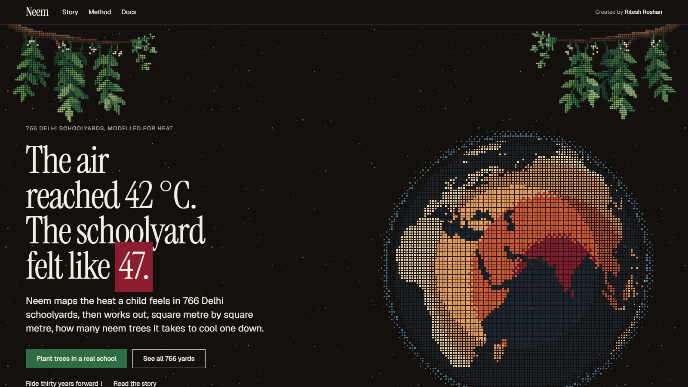
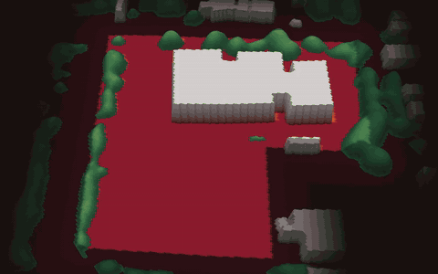
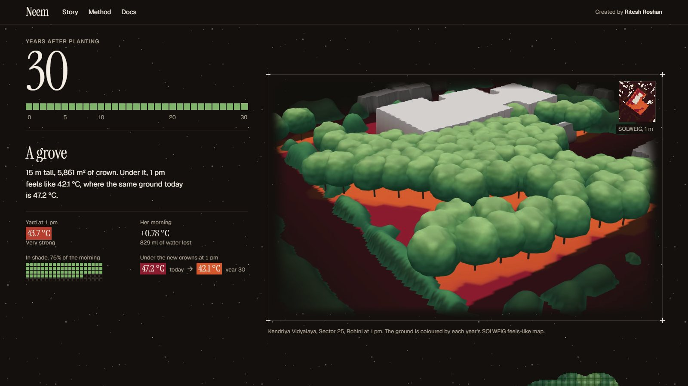
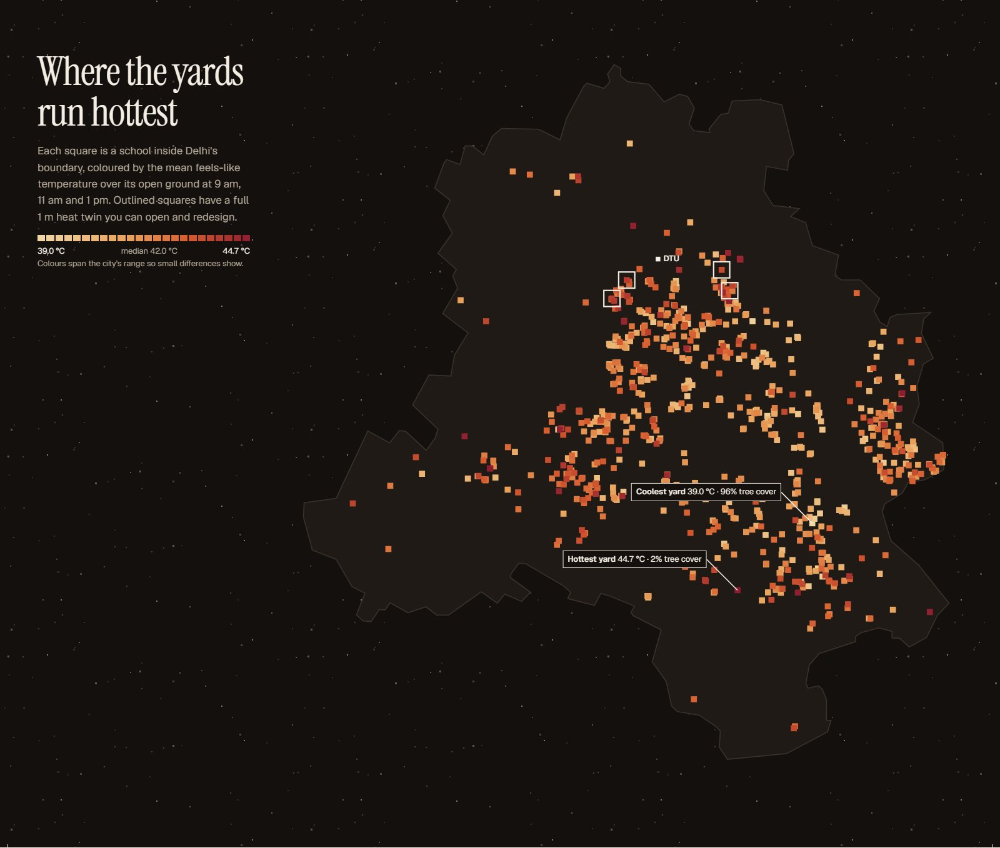
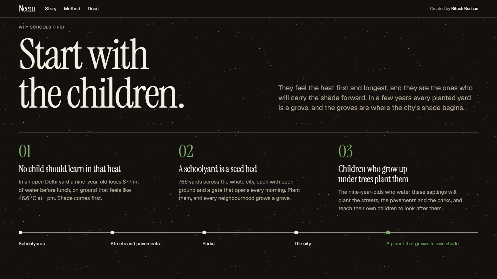
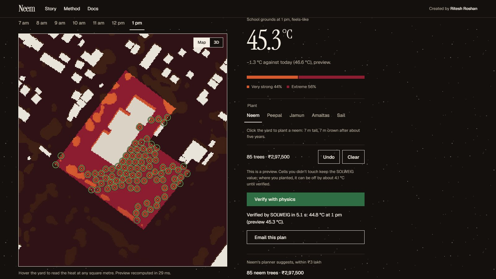
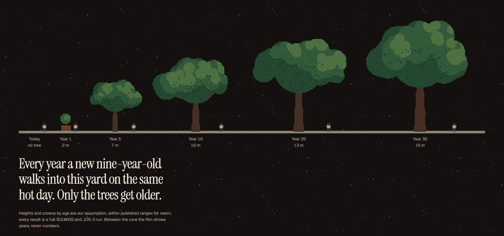

# Neem

**The air reached 42 °C. The schoolyard felt like 47.**

Neem works out how hot every square metre of a Delhi schoolyard feels to a child on a heatwave day. Then it plants neem trees where they will do the most good, checks the plan with real radiation physics, and grows it for thirty years. A school sees the shade arrive before anyone picks up a spade.

**[neem-lemon.vercel.app](https://neem-lemon.vercel.app)** · [The story](https://neem-lemon.vercel.app/story) · [Method](https://neem-lemon.vercel.app/method) · [Developer docs](https://neem-lemon.vercel.app/docs)



## Thirty years in one scroll

<p align="center">
  
</p>

Kendriya Vidyalaya, Sector 25, Rohini, 2.9 km from DTU. Neem's planning agent put 85 neems in its yard for ₹2,97,500. Then we grew them. Every age is a full SOLWEIG and child-twin run on the same heatwave Monday, so the trees are the only thing that changes.

| At 1 pm on 27 April 2026 | Today | Year 5 | Year 30 |
|---|---|---|---|
| The open yard feels like | 46.6 °C, extreme | 44.8 °C | 43.7 °C |
| Share of the morning in shade | 22% | 57% | 75% |
| Under the new crowns, against the same ground today | | 42.7 vs 47.4 °C | 42.1 vs 47.2 °C |
| A nine-year-old's core rise and water lost by 12:45 | +0.93 °C, 877 ml | +0.82 °C, 843 ml | +0.78 °C, 829 ml |
| Crown cover | | 2,971 m² | 5,861 m² |

On the site it plays as a ride. Scroll, and the yard grows in 3D beside each year's numbers, landing on the exact frame of every modelled year. How big a neem gets by each age is our assumption, inside published ranges. Everything else is physics.



## What 766 yards say

On Monday 27 April 2026, Delhi's hottest school day before the summer break, Neem modelled the open ground of **766 schools**.



- **Shade explains almost everything.** The leafiest quarter of yards (68% tree cover) runs 2.8 °C cooler than the barest (15%). Across all 766, canopy and yard heat correlate at r = −0.95.
- **One yard in three** spends more than a quarter of the school morning in extreme heat stress, a feels-like temperature above 46 °C.
- **At Kendriya Vidyalaya** a nine-year-old on the morning shift loses about **877 ml** of water, and their core temperature climbs 0.93 °C above rest by 12:45.

Every number in this README comes from a model run you can repeat.

## Why schools first



Children feel the heat first and longest, so they come first. A schoolyard is also open ground in every neighbourhood, with a gate that opens every morning, and the kids who water these saplings grow up to plant the streets, the pavements and the parks. Every planted yard becomes a grove, and the groves are where a city's shade begins.

Schoolyards are the first ring. The long goal is terraforming, the gentle way: a city, then a country, that grows its own shade.

> A society grows great when old men plant trees in whose shade they know they shall never sit.
>
> Greek proverb

## How it works

**Physics, not vibes.** SOLWEIG, the radiation model urban climate researchers use, computes the full radiation budget of a person standing on each square metre: shadows from buildings and crowns, how much sky each spot sees, and the heat thrown back by sun-baked ground and walls. One school takes about four seconds on a laptop GPU.

**Open data, mostly on AWS.** Buildings come from Overture Maps, read straight off S3. Only 3 of the release's 512 files overlap Delhi, so the pipeline reads those three and skips the rest. Tree heights come from Meta and WRI's canopy map, also on S3. Ground height comes from Copernicus, schools from OpenStreetMap and weather from ERA5.

**Instant, then verified.** Dragging a tree can't wait four seconds, so the browser predicts the *change* from the physics in about 10 ms. Untouched squares keep SOLWEIG's exact value. "Verify with physics" reruns SOLWEIG on your design, and until it lands the page tells you how far the preview could be off.



**A child, not an average.** JOS-3 models a body as 17 segments. We scale it to a nine-year-old and walk it through a government school's morning shift: assembly, class, recess and the walk home. It reports the rise in core temperature above rest and the water lost. Its set points come from adults, so absolute temperatures stay out of it.

**A planner that can't make numbers up.** A Strands agent on a local open model decides how many trees and which species. Its tools decide where (the hottest open ground, a crown apart), enforce the budget, preview and run SOLWEIG. A language model may choose. Only physics may report.

**Drawn in cells.** Everything on the site, from the turning Earth to these trees, is drawn in square cells, like the 1 m grid the physics runs on.



## Built with AWS open source

| Tool | What it does here |
|---|---|
| **Strands Agents SDK** | The planner agent, on qwen3 via Ollama: brief, plant, preview, verify |
| **SAM CLI** | `infra/template.yaml` describes the whole serverless stack: an API Lambda behind API Gateway, a worker Lambda on SQS, a Step Functions Distributed Map over 766 schools, DynamoDB and S3. `sam build` and `sam local` run it on the laptop |
| **LocalStack** | Emulated S3, SQS, DynamoDB and Step Functions, with the lake seeded into S3 so Lambda code reads it exactly as on AWS |
| **Cedar** | Policy as code. Anyone may explore, physics runs have a size and rate budget, and only a school's own planner may approve its plan, never an unverified one |

## Run it

```sh
git clone https://github.com/riteshroshann/neem && cd neem
uv sync && just check                  # Python: lint, types, 64 fast tests
cd web && bun install && bun run dev   # the site on :4321
uv run neem-api                        # the physics API on :8000
```

The data pipeline rebuilds everything from public sources: `just ingest`, `just scene <id>`, `just rank`, `just publish`. Grow a plan with `uv run neem-data grow`. The serverless stack: `just localstack`, `just seed`, `just sam-build`, `just sam-worker`. The planner: `just plan osm-w1321574340`. The [developer docs](https://neem-lemon.vercel.app/docs) walk through every piece in plain words.

## How we know it's right

- **Property tests** pin geometry that must always hold: a taller building never lights a shaded cell, and planting never adds sun.
- **Differential tests** set independent implementations against each other. Our shadow caster agrees with SOLWEIG on more than 97% of cells, the preview stays within 1 °C of SOLWEIG over a yard it has never seen, and the browser's TypeScript port reproduces the Python on a shared fixture.
- **Two bugs these tests caught.** SOLWEIG quietly rewrites the arrays it's given, and DynamoDB rejects float attributes. Both are fixed and covered.
- **Reruns.** `neem-data verify-plan` reran every stored plan through SOLWEIG from scratch and reproduced every number exactly.

Design decisions live in [docs/adr](docs/adr) and the system design in [docs/architecture.md](docs/architecture.md).

## What's next

**A phone in every yard.** Open data knows the height of only about 0.5% of Delhi's buildings. `recon/` turns a 60 to 90 second phone video of an empty yard into a 3D model and measured heights on the same 1 m grid, with VGGT. Next, the same footage becomes a Gaussian splat you can walk through in the browser, with an open-source renderer such as World Labs' Spark.

**Every city.** Every source is global, so another city is a new boundary and a new day.

**Every summer.** Rerun the same twins each year with fresh canopy data to see which saplings made it and what they are doing for the children under them.

**Partners.** NGOs, CSR teams and foundations can use Neem to choose schools, plan inside a budget and report the cooling, year after year. [Start here](https://neem-lemon.vercel.app/docs#partners).

## Credits

SOLWEIG and UMEP (GPL-3.0), pythermalcomfort and JOS-3 (MIT), Overture Maps (ODbL), Meta and WRI canopy height (CC BY 4.0), Copernicus DEM, OpenStreetMap contributors (ODbL), ERA5 via Open-Meteo, VGGT (Meta), numba, DuckDB, rasterio, GeoPandas, FastAPI, Astro, React and three.js.

## License

Copyright (C) 2026 Ritesh Roshan. GPL-3.0-or-later, because SOLWEIG is.

Engineered by Ritesh Roshan.
