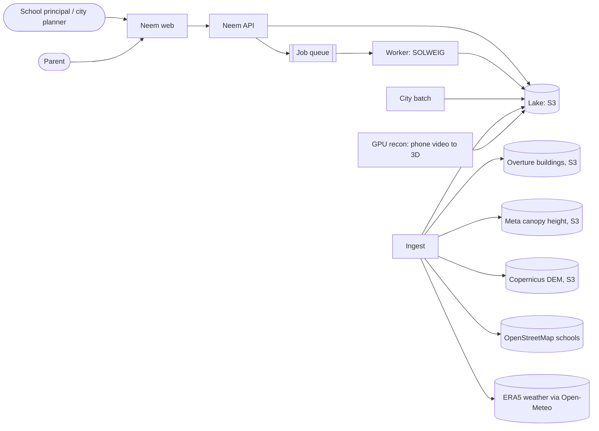
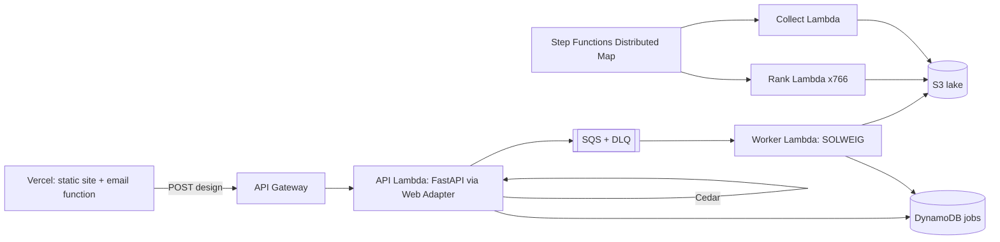

# Neem architecture

Neem answers one question for any school in Delhi: how hot does each square metre of this schoolyard feel to a child, hour by hour on a heatwave day, and what is the cheapest change that makes it safe? Every number it shows comes from a reproducible physics run.

## Goals and non-goals

Goals
- 1 m resolution radiant-heat physics (SOLWEIG) for any school, from open data alone.
- Interactive design: a planner drags a tree and sees the effect in under 100 ms, then gets a physics-verified answer in seconds.
- City scale: rank every school OpenStreetMap knows by heat exposure.
- A child body twin: core temperature and sweat loss for a real school-day schedule.
- Runs fully on a laptop (Docker, emulated AWS); deploys to AWS with the same images.

Non-goals
- Indoor heat. Classroom thermal modelling is a different model class.
- Weather forecasting. We consume forecasts and reanalysis; we do not produce them.
- Medical advice. The child twin is a scaled adult model and is labelled as such.

## System context



## Fidelity tiers

The core design choice is multi-fidelity: cheap models search, expensive models verify (ADR 0002).

| Tier | Model | Where | Latency | Used for |
|---|---|---|---|---|
| T0 | Shadow casting on the DSM + per-hour calibrated Tmrt/UTCI regression | Browser (TypeScript) and Python | under 100 ms | drag-a-tree preview, optimiser inner loop |
| T1 | SOLWEIG, full radiation budget, 1 m | Worker (GPU locally, CPU on Lambda) | 2 to 6 s per school-day | verifying a design, the showcase twin |
| T2 | SOLWEIG at 2 m, two hours | City batch | about 1 s per school | ranking every school |

T0 is calibrated against T1 for each school and each hour. A differential test fails the build if T0 drifts from T1 beyond its error budget (MAE 2.5 °C Tmrt on held-out designs).

## Containers

| Container | Responsibility | Local | AWS |
|---|---|---|---|
| ingest (`neem-data ingest`) | Pull open data for the Delhi AOI, normalise to GeoParquet and COG | CLI | Step Functions task |
| scene builder (`neem-data scene`) | Rasterise one school to DSM / CDSM / DEM at 1 m, EPSG:32643 | CLI | Lambda |
| city batch (`neem-data rank`) | Map `rank_one(school)` over all schools | process pool | Step Functions Distributed Map over Lambda |
| api (`neem-api`) | Read models from the lake, enqueue jobs, child twin on demand | uvicorn | Lambda via Lambda Web Adapter, API Gateway |
| worker (`neem-worker`) | Consume jobs, run T1, write results | container | Lambda (container image), SQS trigger |
| web | Editorial site, map, drag-a-tree | Astro dev server | S3 + CloudFront |
| recon | Phone video to Gaussian splat and DSM | Docker with GPU | SageMaker or EC2 G instance (optional) |

The batch handler is one pure function. The local executor and the Distributed Map item processor both call it, so what we test locally is what runs in AWS (ADR 0005).

## Data model

The lake is plain files on S3: GeoParquet for vectors and tables, Cloud-Optimised GeoTIFF for rasters, JSON for small manifests. DuckDB queries it in place. There is no database server (ADR 0003).

```
s3://neem-lake/
  raw/overture/buildings/delhi.parquet
  raw/canopy/meta-chm/{quadkey}.tif
  raw/dem/copernicus-30m/{tile}.tif
  raw/osm/schools/delhi.parquet
  raw/met/{date}.json
  scenes/{school_id}/scene.npz          # dsm, cdsm, dem, zones; 1 m, EPSG:32643
  scenes/{school_id}/scene.json         # bounds, transform, provenance
  runs/{school_id}/{run_id}/            # SOLWEIG outputs per hour, summary, calibration
  rank/{date}/schools.parquet           # city ranking
  jobs/{job_id}.json                    # job result payloads
```

Job state lives in DynamoDB (`neem-jobs`, key `job_id`). Writes are conditional on state transitions (queued to running to done or failed), which makes the worker idempotent under SQS at-least-once delivery.

Every artefact records provenance: input dataset versions, the code commit and the model parameters. A run is reproducible from its `run_id`.

## Interfaces

HTTP API (OpenAPI is the contract; the web client is generated from it):

- `GET /schools?order=hottest&limit=100`: the ranking
- `GET /schools/{id}`: school metadata, hourly summary, layer URLs
- `GET /schools/{id}/calibration`: T0 coefficients for the browser
- `POST /schools/{id}/designs`: submit interventions; returns a job id
- `GET /jobs/{id}`: job status and result
- `POST /twin/child`: run the child body twin for a schedule

Ports and adapters isolate AWS: `BlobStore` (S3), `JobQueue` (SQS), `JobStore` (DynamoDB). Locally the adapters point at moto server; in tests they use moto in-process (ADR 0004).

## Capacity

- Delhi NCT is about 1,480 km². OSM holds a few thousand school features.
- T2 per school: a 2 m grid of roughly 150 x 150 cells, SVF plus two timesteps, about 1 s on GPU and 5 to 10 s on one CPU core. A full city run fits in an hour on a laptop and in minutes on Lambda at 100 concurrency.
- T1 per design: a 1 m grid of about 250 x 250 cells, about 4 s on GPU locally. Lambda needs 3 to 6 GB memory and CPU time well under its 15 minute limit.
- Lake size: Overture buildings for Delhi are a few hundred MB as GeoParquet; canopy tiles for the AOI are about 1 GB; per-school scenes are under 1 MB compressed.

## Failure modes

| Failure | Effect | Handling |
|---|---|---|
| Missing building heights in Overture | DSM underestimates shade | Fill from floor count x 3.2 m, else a footprint-area prior; flag the school's data quality score |
| Canopy tile missing | No trees in scene | Mark the scene degraded; never rank a degraded scene silently |
| Worker crash mid-job | Job stuck in running | SQS visibility timeout redelivers; conditional writes keep it idempotent; DLQ after 3 attempts |
| T0 drift from T1 | Preview misleads | Differential test in CI; UI always shows the verified T1 value when it arrives |
| Open data endpoint flaky | Ingest fails | Retries with backoff; ingest is resumable per tile |

## Security and privacy

- No personal data is stored. Schools are public places from public datasets.
- Phone footage for recon must contain no children; the recon pipeline is for empty grounds only.
- AWS access follows least privilege per function; the lake bucket is private and the web reads layers through CloudFront with signed or public-read prefixes only for derived artefacts.

## Observability

Structured JSON logs with `run_id` and `job_id` on every line. Each job emits timing for its stages (scene load, SVF, timesteps, write). CloudWatch dashboards and alarms in AWS; plain logs locally.

## Testing strategy

See `docs/testing.md`. In short: property-based tests for geometry invariants, differential tests between independent implementations (numba shadow caster vs SOLWEIG, Python T0 vs TypeScript T0), golden tests for SOLWEIG outputs on a fixture yard, contract tests against the OpenAPI schema, and integration tests against the local stack.

## Added on day two

### Authorization (ADR 0008)

Cedar policies in `packages/neem-api/src/neem_api/policies/neem.cedar`, validated against a schema, guard the two endpoints that cost compute or change a record. Reads stay open. Verification is allowed within a size and rate budget (200 trees, 40 sails, 20 jobs per identity per hour). Approval needs the school's own planner (or an admin) and a verified run; a `forbid` makes the second condition hold for everyone. Identity comes from the auth layer: a server-side token table locally, Cognito claims on AWS.

### Planner agent (ADR 0009)

`neem-agent` runs a Strands Agents loop on a local open model (qwen3 4B via Ollama). The model picks quantities and species; tools pick locations (hottest-first, a crown apart, clear of buildings), enforce the budget, preview with T0 and verify with SOLWEIG. The site shows each school's agent plan with its verified numbers, so the public deployment carries physics results without a physics server.

### Serverless shape, locally (ADR 0010)



`infra/template.yaml` (SAM) is the single description. Locally, `sam build` builds the one container image, `sam local invoke` / `start-api` run the functions, and LocalStack 4.14 provides S3, SQS, DynamoDB and Step Functions with the lake seeded into its S3. The same image runs under docker compose.

### Web delivery

The site is static Astro on Vercel. Twin layers, calibration, child days and agent plans are static files, so the drag-a-tree preview runs entirely in the browser. One Vercel Function sends a school's plan by email through Resend, to a recipient fixed in configuration.

## Added on day three

### Every number on the page has a run behind it

`neem-data verify-plan` re-runs each stored planner design through SOLWEIG and keeps the field in `runs/{id}/{day}-plan/`. `publish` paints that field as the "after" map and writes `web/src/data/showcase.json`: the sun the model used for the 1 pm hour (taken at mid-hour, as `MetHour.sun` does), the subsolar point at the same instant, one square metre's inputs and the plan's numbers, all read from stored runs. The home page, the story page and the social card read from it; nothing on them is typed by hand.

### Colours and categories are separate

The heat ramp is a continuous colour scale with anchors at 26, 32, 38, 42 and 46 °C. The UTCI heat-stress categories (moderate from 26, strong from 32, very strong from 38, extreme from 46) live in their own list in `neem_core/palette.py`, are exported through `palette.json`, and drive every legend and band share. Tests pin both sides.

### Frugal first paint

School pages show the 1 pm map as an image straight away. The planner island fetches the 0.8 MB heat field only after the largest paint, so the field never sits in the page's critical path.
